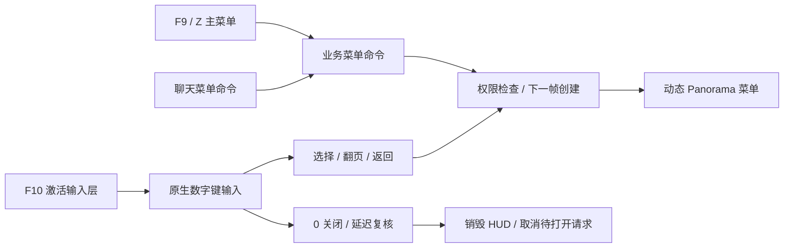

# 无线电数字菜单与回合冻结修复验收

日期：2026-10-12；交付版本：ZePractice 1.1.3。本文接续“修复 CS2 服务器启动闪退”对话，记录数字菜单和再次出现的 0:00 冻结两项收尾。

> 历史专项验收：当前已升级至 1.2.0。现在所有玩法模式均禁止自动回合结束，明确的全员 `!ze_restart`/`!ze_endround` 才推进；本文的“仅练习模式”描述属于旧行为。新玩法见同目录《全员玩法与指令-1.2.0》。

## 最终收尾结果

2026-10-12 06:48（Asia/Shanghai）完成中断后的交付核对：

- 将最终 `radio_filter.js` 与 `RadioFilterTests.cjs` 同步到运行副本，使用原有 Deploy-Tracked 逐文件清单，保留首次备份。修复此前“客户端已安装最终资源，但运行副本仍保留旧源码”的不一致。
- 临时 `ZeMenuVerify` 插件已从服务器插件目录移至测试目录的 `removed-live-probe`，不再随正常开服加载；验收源码、DLL 和历史截图仍保留。
- 重新执行 **20/20 套自动回归**，包含 11 套 .NET 测试和 9 套脚本测试。最终 RadioFilter 为 **12/12**，不是旧记录中的 6/6；Release 编译为 **0 警告、0 错误**。
- 客户端 **8/8 个受管理文件**与最后一次安装清单 SHA256 一致，动态 HUD VPK 与最终构建包一致，编译输入与当前关闭逻辑源码一致；没有为收尾重复改写客户端。
- 无临时探针的专服冷启动 **8/8 项检查通过**：指定 Workshop 地图 active、仅正式 ZePractice 1.1.3 CSS 插件加载、三个原生依赖存在、冻结保护启用、无冻结/结算、时钟继续推进、无残留菜单、0 在线玩家。
- 本轮时钟与 `lastThink` 同步从 **112.125 → 115.5** 推进，`guardInstalled=true`、`freeze=false`、`intermissionEnd=0`。
- 02:00 保存的 **15/15 项交互验收**继续有效，覆盖数字键、上下页、选择、子菜单、返回、0 关闭、F10、热重载和三次强制结算拦截。本轮没有重新启动客户端，也没有将旧截图当作新的交互测试。
- 验证结束后确认 0 在线玩家，发送 RCON `quit` 并确认本轮专服进程退出，恢复接手时的停服状态。正常使用时双击既有 `E:\mapper\chana\ZePractice\run.bat`。

证据根目录：`E:\mapper\chana\临时文件夹\ze-radio-menu-finish-20261012`。

| 证据文件 | 内容 |
|---|---|
| `completion-summary.json` | 最终源码、部署、客户端散列与清理状态总览 |
| `completion-regression\results.json` | 本轮 20 套回归结果与逐套日志位置 |
| `completion-regression\ReleaseBuild.log` | 本轮 Release 编译结果 |
| `final-runtime-results.json` | 02:00 的 15 项客户端交互验收 |
| `completion-live-checks.json` | 06:47 的 8 项干净专服冷启动检查 |
| `final-server-state.txt` | 停服前的插件、回合、菜单和地图状态 |
| `completion-shutdown.json` | 本轮专服退出确认 |

## 使用方法

- 开服入口仍为 `E:\mapper\chana\ZePractice\run.bat`；客户端连接 `127.0.0.1:27015`。
- **F9 或 Z**：打开无线电主菜单。按菜单中的数字进入个人辅助、补给、职业、地图或管理菜单。
- 动态菜单直接显示真实标题和选项，不再要求对照聊天区的“第几项”。每页 6 项；**1–6 选择、7 上页、8 下页、9 返回主菜单、0 关闭**。
- **F10**：激活当前动态面板的数字键输入。通过聊天指令（例如 `!zeclass`、`!zeweapon`）打开面板后，按一次 F10 再选数字；F10 不重建服务端菜单，也不会丢失当前页。已经能用数字选择时无需再按，重复按会切换无线电输入层。
- ALT 穿墙、F11 无敌、INS 存点、HOME 回点、END 删点；FYS 的 F5/F7/F8 未改。0 仍保留原来的 `exec bind.cfg`，并重新应用本项目的受管理快捷键。
- 数字选项继续经过服务端原有权限检查；禁用项、空行和超出范围的编号不会执行。

## 修复内容

### 动态菜单

保留原生无线电捕获数字键，以独立 Panorama HUD 显示实际业务菜单。原生 report 组仅作输入层，由专用标记隐藏其重复的占位文字；普通无线电主菜单和个人辅助菜单仍显示。

服务端采用编译布局 keyvalue 生成 custom_hud_layout；Windows HUD 字符串结构通过当前 server.dll 的 RTTI 定位有效 vtable。菜单初始化和选择移到下一帧，避免在客户端指令回调里进行首次重型渲染。待打开菜单带请求序号；关闭、断线、换图会取消旧请求，选项打开新子菜单时不再被旧菜单覆盖。

聊天命令只在服务端创建 HUD，不等于客户端自动进入无线电按键模式；F10 是明确的客户端入口。没有全局改绑 1–9，也没有通过反复发送命令抢夺普通武器数字键。

原生数字 0 关闭输入层时，客户端监听 `ShowHudRadio` 从显示变为隐藏，延迟 0.15 秒后确认仍关闭，再发送 `css_ze_ui_close` 同步关闭服务端 HUD。快速重新打开输入层时取消该关闭动作；普通无线电主菜单和已销毁的面板不触发误关闭。此逻辑包含在最终 12 项 RadioFilter 回归中。

### 0:00 冻结

此前实际异常是比赛进入 intermission 后 GameRules 停止推进，不只是回合时间显示错误。除独立服务器 cfg 外，练习模式新增 intermission 入口拦截；偏移读取已安装 CS2Fixes gamedata 中命名的 CCSGameRules_GoToIntermission 项，不在插件里固定某个数字。

拦截仅在 `PracticeMode=true` 且 `PreventPracticeIntermission=true` 时生效；普通 ZE 模式继续走原始逻辑。正常回合重开仍使用 `!ze_restart`。更新游戏或 CS2Fixes 后检查 `css_ze_round_status`，关注 `guardInstalled=true`、`freeze=false`、`intermissionEnd=0`，并连续查询确认 `lastThink` 和 `now` 一起推进。

已验证的主动 intermission 调用增加 blocked 计数，但没有冻结玩家或停止回合时钟。此结论针对本机已安装版本与 ze_forhidden_slicoo_cn，不能推导为全部地图、全部关卡和多人场景都已验收。

## 部署位置与边界

| 内容 | 位置 |
|---|---|
| 项目源码 | D:\34184\Documents\ChatGPT\CS2脚本\ZePractice |
| 运行副本与开服入口 | E:\mapper\chana\ZePractice |
| 插件 | E:\mapper\chana\steamapps\common\Counter-Strike Global Offensive\game\csgo\addons\counterstrikesharp\plugins\ZePractice |
| 本机客户端 | D:\SteamLibrary\steamapps\common\Counter-Strike Global Offensive 730\game |
| 测试、截图和本轮备份 | E:\mapper\chana\临时文件夹\ze-radio-menu-finish-20261012 |

无线电模式的客户端安装器管理 8 个文件：main.vxml_c、main.vcss_c、ze_practice_keys.cfg、autoexec.cfg、bind.cfg、gameinfo.gi，以及 ze_practice_radio 目录内的 ze_practice_radio.vpk 和 ze_dynamic_hud.vpk。gameinfo.gi **仅增补两个独立资源包的搜索路径**；不是整份覆盖，未改 Workshop 地图 VPK。

旧的 1.1.0 更新记录中“四个文件、没有改 gameinfo.gi”只描述当时的鼠标面板安装，不适用于现在的 RadioMenu 安装。没有修改现有 RCON 密码、管理员名单、FYS 原始配置、旧更新 run.bat 或旧全局 server.cfg。

## 回归与证据

自动回归结果：`E:\mapper\chana\临时文件夹\ze-radio-menu-finish-20261012\final-regression\unit-results.json`。

已执行 11 个 .NET 测试套件：RadioPanel 30、ZePanel 81、CommandText 94、Permission 79、AdminAccess 58、AdminPractice 85、RoundGuard 17；另有 Gameplay、EntWatch（62）、BossTranslation（1046）和 MapConfig 语料检查。测试包括实际 server.dll RTTI 和当前 gamedata 的解析，但纯逻辑测试本身不替代实机验证。

无线电安装/重复安装/精确回滚、普通客户端安装器、RadioFilter、PowerShell 兼容和启动器测试另行保存日志。实机证据记录菜单翻页、选择、子菜单、返回、关闭、热重载、断线清理和练习结算拦截；最终运行状态与具体通过项以同目录的 final-runtime-results.json 为准。

FYS 公共仓库没有当前图的 EntWatch 配置；缺失项没有伪造。地图已有的缺失粒子、雷达等资源提示不属于此次菜单/冻结修复。

## 游戏校验后恢复与回滚

游戏校验可能移除 gameinfo.gi 搜索路径。退出客户端后，使用当前项目重新构建并运行 Install-ZeClient.ps1 的 -RadioMenu 模式；不要拿旧整份 gameinfo.gi 覆盖新的官方文件。安装器重复执行不会重复插入受管理标记。

本轮客户端修改前内容保存于测试目录的 client-live-backups 与 client-final-backups 中，每次安装都有 manifest.json。回滚命令为：

~~~powershell
& 'E:\mapper\chana\ZePractice\tools\Install-ZeClient.ps1' -RestoreManifest 'MANIFEST_FULL_PATH'
~~~

从最新清单开始逆序恢复；安装后又被手改的文件会跳过，避免覆盖后续修改。重启客户端才能重新挂载 VPK。只恢复最后一次清单会回到上一次安装状态，不等于删除此前所有无线电资源。

服务端及运行副本的逐文件首次备份和最新散列仍记录于 E:\mapper\chana\临时文件夹\ze-practice-build-20261011\backup\installed-files.json；回滚服务器文件前先正常停服。临时验收探针在最终验收后移出服务器插件目录，源码和证据只保留在测试目录。
